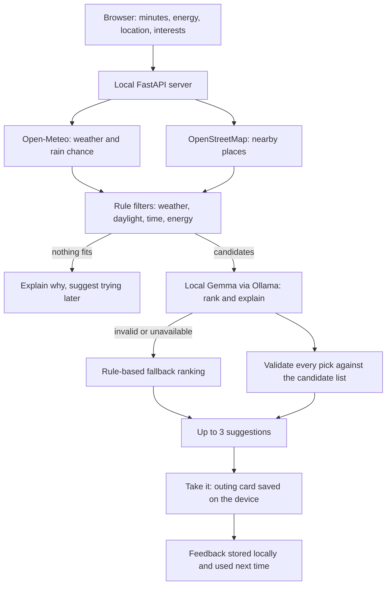

# Touch Grass Planner

Tell it how long you have and how much energy you have. It looks at the weather and the parks, gardens, viewpoints and beaches nearby, asks a **local open-weight model** to pick the best fit, and gives you a small "outing card" you can save. Then you put the phone away and go outside.

It was built for the Hacktoberfest Open-Source AI Challenge, Week 1 ("Touch Grass").

- The model runs on your own machine through [Ollama](https://ollama.com). The default is Gemma.
- Weather comes from [Open-Meteo](https://open-meteo.com) and places come from [OpenStreetMap](https://www.openstreetmap.org) (through the Overpass API). Both are open data with no API key.
- Your feedback (accepted, skipped, done) is stored in a local SQLite file and never leaves your machine.

## How it works



Two design choices matter most:

1. **Rules decide what is possible; the model decides what is good.** Storms, heavy rain, strong wind, extreme temperatures, darkness, and trips too long for the time or energy are removed by plain, tested rules before the model sees anything. The model only ranks places that can actually work.
2. **The model's output is never trusted.** Every suggestion is checked against the candidate list. Invented places, bad JSON and impossible durations are dropped, and if nothing usable is left the app falls back to a simple deterministic ranking.

## Quick start

You need Python 3.11 or newer and [Ollama](https://ollama.com/download).

```bash
# 1. Get a model. Gemma 4 comes in several sizes (E2B, E4B, 26B, 31B).
#    The default tag works, but pick a smaller one if your machine is modest
#    (check the exact tag names on the Ollama library page).
ollama pull gemma4

# 2. Install and run
python -m venv .venv
source .venv/bin/activate          # Windows: .venv\Scripts\activate
pip install -r requirements.txt
uvicorn app.main:app --host 127.0.0.1 --port 8000

# 3. Open http://localhost:8000
```

If you pulled a different tag, tell the app: `export OLLAMA_MODEL=<tag>` before starting the server. The status line at the top of the page tells you whether the model was found.

If Ollama is not running, the app still works with the rule-based fallback and says so.

### Using it on a phone

Run the server on your laptop with `--host 0.0.0.0` and open `http://<laptop-ip>:8000` on a phone on the same Wi-Fi. Only do this on a network you trust, because the app has no login.

Browsers only allow the "Use my location" button on `https` pages or on `localhost`, so on a phone over plain `http` you will need to type a town or city instead.

## Configuration

All settings are environment variables and all are optional. See `.env.example`.

| Variable | Default | What it does |
|---|---|---|
| `OLLAMA_MODEL` | `gemma4` | Which local model to use. Swap it to try another open-weight model. |
| `OLLAMA_URL` | `http://localhost:11434` | Where Ollama is listening. |
| `OLLAMA_TIMEOUT_S` | `120` | How long to wait for the model. |
| `TG_SEARCH_RADIUS_M` | `3000` | How far to search for places. |
| `TG_COORD_DECIMALS` | `3` | Coordinate rounding before outside requests (3 is about 110 m). |
| `TG_ALLOW_AFTER_DARK` | `false` | Allow suggestions after dark. |
| `TG_DB_PATH` | `data/touchgrass.db` | Where local feedback is stored. |

## What leaves your machine

| Data | Goes to | Notes |
|---|---|---|
| Coordinates, rounded to about 110 m | Open-Meteo (weather) and Overpass (places) | Required to look anything up. The precise location never leaves your own server. |
| A typed town or city name | Open-Meteo geocoder | Only when you type one instead of using your location. |
| The model prompt (time, energy, interests, weather, candidate places, recent activity) | Only your local Ollama | Never sent to any outside service. |
| Accept, skip and done feedback | Only a local SQLite file | Never sent anywhere. |

Weather and place lookups need an internet connection, so the app is **local-first, not fully offline**. The saved outing card is a self-contained page that opens with no signal.

## Safety notes

- Weather and daylight limits are simple heuristics (see `app/filters.py`). They are not safety guarantees. Use your own judgement outdoors.
- Place names come from OpenStreetMap, which anyone can edit. The app strips control characters, caps name length, passes names to the model as data, and validates the model's reply, so a strange name cannot add a place to the results.
- This is a lifestyle suggestion tool. It is not medical or mental health advice.

## Tests

```bash
pip install -r requirements-dev.txt
python -m pytest -q
```

The suite covers the filters, ranking, model-output validation, the feedback store and the full API. Every outside service (weather, places, geocoding, Ollama) is replaced with a fake, so the tests run with no internet and no model.

That also means the tests cannot tell you how a real Gemma model replies or whether OpenStreetMap has good data near you. Both are checked by running the app, see `docs/BUILD_LOG.md`.

## Compare models

To get real numbers for how different local models behave on the same scenarios:

```bash
python scripts/compare_models.py gemma4 <another-model> --runs 3
```

It prints a Markdown table with the share of valid replies and median latency per model. The numbers depend on your hardware.

## Known limits

- OpenStreetMap coverage varies by region. Some areas have few named parks or viewpoints.
- Walking times are estimates (straight-line distance times 1.3, at about 4.8 km/h).
- There are no live events yet. Places only.
- Suggestions do not learn beyond a short memory of recent outings. A bandit-style learner is future work.
- The interface is English only.

## How this project was built

The initial scaffold (backend, tests, interface and documentation) was generated with Claude on 2026-10-07. Everything done after that, and which tool was used for it, is recorded in `docs/BUILD_LOG.md`. See `docs/ARCHITECTURE.md` for how the code is organised, and `docs/PROJECT_BRIEF.md` for the full project context written for AI coding agents.

## License

MIT. See `LICENSE`. Data from OpenStreetMap is licensed under the ODbL; please keep the attribution in the footer.
